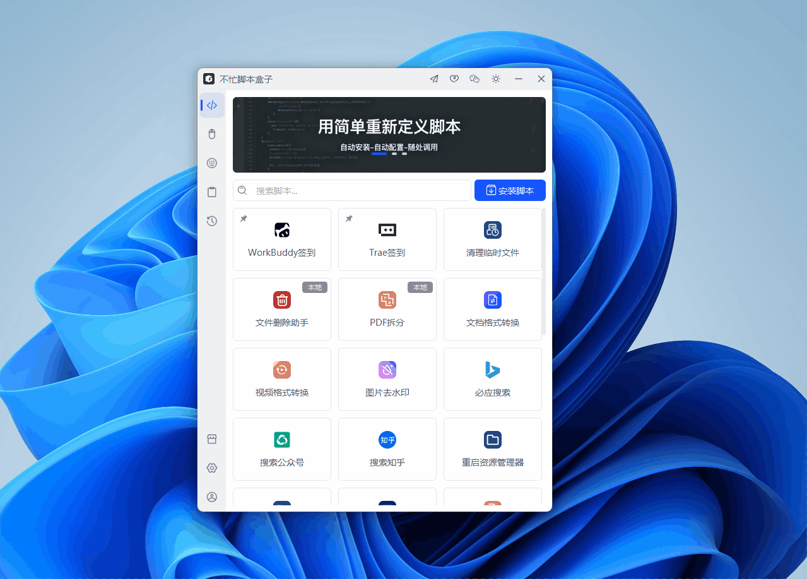

  

<h1 align="center">不忙脚本盒子 · BmScriptsBox</h1>

  
  
  
  

  <a href="https://www.bm-box.cn">官方网站</a> ·
  <a href="https://www.bm-box.cn/scripts">脚本社区</a> ·
  <a href="https://www.bm-box.cn/help/api">开发者文档</a> 

## 关于

BmScriptsBox（不忙脚本盒子）是一款面向 Windows 的跨语言脚本管理器：让普通用户无需接触命令行，也能像使用手机 App 一样查找、安装并一键运行自动化脚本。

内置脚本库覆盖办公效率、音视频处理、AI 应用、系统工具等分类，目前已收录上百个实用脚本。支持运行 Python、JavaScript、PowerShell、AutoHotkey、Batch 等脚本，并兼容 HTML 应用与 EXE 程序。

如果你熟悉 Tampermonkey（油猴），可以把它理解为面向 Windows 桌面自动化的“桌面版油猴”：同样以“找脚本、用脚本”为核心，但管理的是跨语言桌面脚本，而不是浏览器用户脚本。

**如果你觉得有用，请给我们一颗星⭐。这是我们最大的支持！**

## 📸 预览

  

## ✨ 核心功能

### 给普通用户：像管理手机 App 一样使用脚本

- **全图形化**：脚本安装、启动、管理、卸载均可视化操作，点击脚本卡片即可运行，零基础也能上手。
- **内置脚本社区**：一键检索、安装优质脚本；已安装脚本支持自动检测与更新。
- **快速唤醒**：鼠标中键单击或双击 Ctrl，均可快速唤醒脚本面板。
- **右键菜单启动**：脚本可挂载到系统右键菜单，选中文件或文件夹即可启动，并自动带入路径参数。
- **全局快捷键启动**：为脚本配置全局快捷键后，在任意窗口按预设快捷键即可启动，并自动带入路径参数。
- **超级复制启动**：选中任意文字，连按两次 Ctrl+C 唤出超级复制面板，选择对应脚本即可启动，并自动带入选中文本参数。
- **定时任务**：支持一次性、每日、每周、每月循环执行，设置后自动运行，无需值守。
- **开源免费**：完全开源，核心功能不设限，不限脚本安装数量，可自由扩展实用工具。

### 给脚本开发者：一份 TOML 声明接入盒子

- **零侵入接入**：仅需一份 TOML 声明，无需改造原命令行脚本。
- **环境依赖自动配置**：自动创建虚拟环境、安装依赖；支持 FFmpeg、Pandoc 等工具自动下载注入，HuggingFace、ModelScope 模型按需拉取与跨脚本复用。
- **命令行脚本一键生成 GUI**：TOML 声明自动渲染界面，无需学习 UI 框架或编写 GUI 代码。
- **声明式定时调度**：配置即托管定时触发，参数自动映射到可视化面板，开发者无需编写调度底层代码。
- **多场景参数注入**：右键菜单、全局快捷键、剪贴板、选中文件路径等可自动作为参数传入脚本；提供统一参数、返回和错误码契约。
- **脚本协作**：脚本可同步调用其他脚本，内置友好 HTTP 调用接口，无需额外开发服务代码。
- **脚本分发**：支持本地 ZIP、GitHub 仓库、脚本社区三种安装源，并可通过 GitHub Webhook 自动更新社区脚本。

## 快速入门

### 安装软件
- **普通用户（推荐）**：从 [Releases](https://github.com/bm-qihengzhi/BmScriptsBox/releases/latest) 下载安装包，支持 Windows 10 / 11。安装包已内置运行时与依赖，开箱即用。
- **技术用户**：源码仓库仅含主程序本体，需自行准备脚本运行时、依赖与右键菜单扩展。

### 使用指南
1. **从脚本商店安装脚本**：在软件中进入「脚本商店」窗口，选择脚本并点击安装。
2. **安装本地私有脚本**：在脚本目录中添加 `toml` 声明文件，打包成 `zip` 后，通过本地安装将脚本装进盒子。
3. **分发脚本（开发者）**：完成盒子适配后，将脚本提交到 GitHub 仓库，再把仓库地址提交给盒子，即可发布到社区。

## 脚本开发

BmScriptsBox 是一个高自由度、低侵入的脚本运行底座：不绑定特定语言，没有 SDK，也无需 `import` 盒子的任何库。使用 Python、JavaScript、PowerShell、AutoHotkey、Batch 等语言编写的脚本，只需一份 `TOML` 声明即可接入，自动获得图形界面、参数注入、定时调度与分发能力，无需编写 GUI 或打包成 exe。

盒子覆盖开发、分发与更新全流程，帮助开发者用尽量少的代码获得完整的使用体验。

查看[开发文档](https://www.bm-box.cn/help/api)，了解盒子的运行机制与 `TOML` 声明文件的基本规范。

## 贡献

- **脚本**：写好脚本和声明文件，提交 GitHub 仓库地址即可发布到社区；
- **代码**：建议先开 Issue 说明场景，再提 PR，分支命名 `feat/xxx`、`fix/xxx`、`docs/xxx`；
- **文档与翻译**：使用说明、开发文档、错误提示的措辞都可以改。

提 Issue 时请附上：系统版本、盒子版本、相关脚本、复现步骤，以及日志或截图。

## 许可证

**MIT License + Commons Clause**，属于 source-available，不属于 OSI 定义的开源许可。

- 个人与组织内部使用免费；
- 可以阅读、修改、自行编译；
- 商业用途（售卖、打包收费、对外收费服务等）需作者书面授权。

完整条款见 [LICENSE](./LICENSE)。商业授权请联系：bmscriptsbox@163.com

Copyright © 2026 綦恒智 (Qi Hengzhi)
